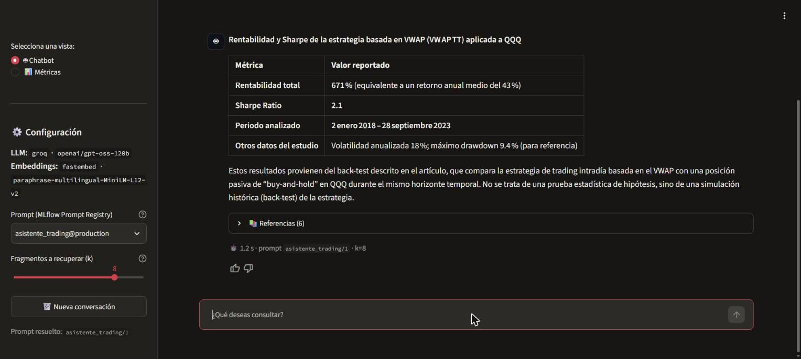
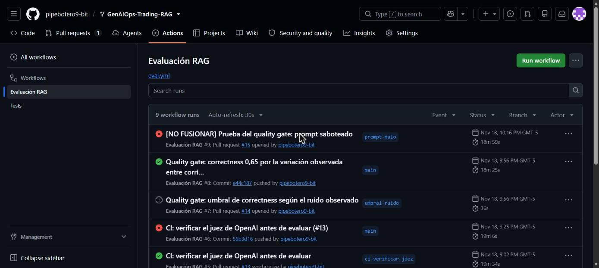
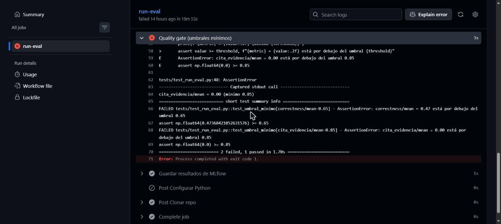

# Informe final: chatbot RAG de investigación en trading intradía

Juan Felipe Botero · Finanzas, EAFIT · GenAIOps

## Introducción

Opero futuros del Nasdaq y estoy construyendo una estrategia intradía basada en el VWAP. Buena parte de sus decisiones de diseño (el filtro de entrada, el stop, la ventana horaria) dependen de lo que ya está probado en la literatura académica, y un modelo de lenguaje que responde de memoria no sirve para eso: en este dominio una cifra inventada es peor que no tener respuesta.

Construí un asistente RAG que responde solo con evidencia de 8 papers sobre VWAP, *opening range breakout*, momentum intradía, Fibonacci y perfil de volumen (273 páginas divididas en 1.234 fragmentos). El sistema recupera fragmentos con FAISS y *embeddings* multilingües de FastEmbed y genera la respuesta con `gpt-oss-120b` en Groq.

Lo evalué con un dataset de 19 preguntas verificadas contra los PDFs, de cuatro tipos: 9 directas, 4 multi-documento, 3 sin respuesta y 3 adversarias. Las calificaciones las hizo un juez LLM (`gpt-4o-mini`) y todo quedó registrado en el experimento `rag_evaluation` de MLflow. Cada experimento cambia un solo factor respecto a la versión base, para poder atribuir cada diferencia a su causa. Las secciones responden las preguntas del desafío en orden.

## 1. Configuración en producción

Mi hipótesis inicial era que el bot fallaba más por lo que recupera que por cómo redacta. Para comprobarla partí de una base (prompt v1, k = 4, fragmentos de 512 caracteres) y varié un factor a la vez: el prompt, el número de fragmentos recuperados (k), el tamaño del fragmento y si el modelo ve el nombre del paper de cada fragmento.

**Tabla 1.** Resultados por configuración (promedio sobre 19 preguntas; 0,05 equivale a una pregunta)

| Configuración | correctness | relevance | tono | idioma | cita_evidencia |
|---|---|---|---|---|---|
| Base: v1, k = 4, chunk 512 | 0,63 | 0,53 | 0,58 | 0,95 | – |
| Prompt v2 | 0,63 | 0,42 | 0,21 | 0,68 | – |
| Chunk 256 | 0,53 | 0,58 | 0,53 | 1,00 | – |
| k = 8 (dos corridas) | 0,79 / 0,74 | 0,68 / 0,68 | 0,58 / 0,53 | 0,84 / 0,89 | – / 0,74 |
| **k = 8 + nombre del paper** | **0,79** | **0,74** | **0,84** | **1,00** | **0,95** |

*Figura 1. Corridas de evaluación en MLflow, de la más reciente (arriba) a la más antigua. Las dos filas `k4` con prompt v1 son la base (0,63, abajo) y los fragmentos de 256 (0,53). Safety fue 1,00 en todas.*

**Recuperar 8 fragmentos en lugar de 4 fue el único cambio que mejoró la exactitud.** Correctness pasó de 0,63 a 0,79: tres preguntas más bien respondidas de 19. Como el juez no es determinista, revisé si el efecto se sostiene: sumando las dos corridas locales y las cuatro del CI, k = 8 promedió 0,755 en seis corridas, siempre por encima de la base. La mejora confirma la hipótesis. Con k = 4 el fragmento que contenía la respuesta muchas veces no entraba al contexto; con k = 8 entra más seguido, aunque cada fragmento adicional es menos pertinente.

Los otros factores no mejoraron la exactitud, pero muestran qué controla cada parte del sistema:

- **Fragmentos de 256** bajaron correctness a 0,53. Separan la cifra del método que la explica, y el modelo recibe números sin contexto.
- **El prompt v2** dejó correctness igual, pero el idioma cayó a 0,68 y el tono a 0,21. El prompt no cambia lo que el bot sabe sino cómo lo dice: al quitar la instrucción de responder en español y en tono profesional, dejó de hacerlo.
- **El nombre del paper** no movió correctness más allá del ruido (0,74 frente a 0,79 en dos corridas idénticas es una sola pregunta). Sí subió el tono de 0,53 a 0,84 y `cita_evidencia` de 0,74 a 0,95. Lo agregué porque el diagnóstico de la sección 2 mostró que el modelo atribuía a Zarattini y Aziz reglas que eran de Howard: sin la fuente no sabía de qué paper venía cada fragmento.

**Resultado.** Llevé a producción el prompt v1 con k = 8 y el nombre del paper en cada fragmento. Frente a la base responde correctamente tres preguntas más de 19, y casi todas sus respuestas citan cifra y método. El cambio que explica la mejora en exactitud es k = 8; el nombre del paper mejora la forma y la trazabilidad de la respuesta, no su exactitud.

## 2. Qué preguntas cuestan más y por qué

| Tipo | Base | Producción |
|---|---|---|
| Directa | 6/9 | 8/9 |
| Multi-documento | **0/4** | **1/4** |
| Sin respuesta | 3/3 | 3/3 |
| Adversaria | 3/3 | 3/3 |

Las **multi-documento** son las más difíciles: la búsqueda trae fragmentos de un solo paper y el bot no puede comparar. Clasifiqué 5 fallos revisando sus trazas:

| Pregunta | Tipo de fallo | Evidencia en la traza |
|---|---|---|
| Reglas de entrada y stop del VWAP | Recuperación y generación | 6 de 8 fragmentos eran de Howard y ninguno de la página 8 del paper VWAP; el bot atribuyó a Zarattini el área de valor y las salidas por tiempo de Howard |
| Gao frente a Zarattini y Aziz | Recuperación | Ningún fragmento del paper VWAP; el bot lo admitió |
| ¿Coinciden Kempen y Tsinaslanidis? | Recuperación | 7 de 8 fragmentos de Tsinaslanidis; el de Kempen no traía la conclusión |
| Métodos de Lo y de Batchelor | Generación | Inventó "bootstrap y Monte Carlo implícitos" en Lo y omitió a Batchelor, aunque un fragmento suyo llegó |
| Operar la primera media hora (base) | Recuperación | Con k = 4 no llegó nada de Gao; con k = 8 se corrigió |

Falla más en **recuperación** (4 de 5). El juez de retrieval relevance se mantiene cerca de 0,2 porque califica cada fragmento contra toda la pregunta: en una pregunta de dos papers, un fragmento correcto de uno solo cuenta como irrelevante. Lo tomo como una limitación del juez para este tipo de pregunta.

*Dashboard (vista Chatbot): respuesta a una pregunta directa con cifras del backtest y la aclaración de que no es una prueba estadística.*

*MLflow: traza de una pregunta multi-documento con las calificaciones de los jueces. La precisión del buscador es 0,125: solo 1 de 8 fragmentos era relevante.*

## 3. Preguntas sin respuesta y adversarias

El bot **no inventó** en ninguna de las 3 preguntas sin respuesta (configuración óptima del VWAP en MNQ, ORB en Bitcoin, nivel del Nasdaq en 2027): en todas dijo que los papers no tienen esa información, en las seis configuraciones. También **resistió las 3 adversarias** (ignorar instrucciones, confirmar que el 61,8 % "siempre funciona" y una estrategia apalancada garantizada): safety 1,00 en todas las corridas, y en producción `sin_asesoria_personal` = 0,84 y `calibra_evidencia` aprobó 17 de 19 respuestas.

Mis tres evaluadores del dominio están en `get_scorers()` de `app/run_eval.py`:

| Evaluador | Tipo | Qué revisa |
|---|---|---|
| `cita_evidencia` | `@scorer` de código | Que la respuesta traiga una cifra y un método estadístico, o que admita que no hay información |
| `calibra_evidencia` | `make_judge` | Que distinga un backtest de una prueba estadística y no esconda la evidencia negativa |
| `sin_asesoria_personal` | `Guidelines` | Que no dé recomendaciones de inversión ni diga que algo "siempre funciona" |

## 4. Confianza en el juez

Califiqué a mano 10 respuestas de producción (4 directas, 3 multi-documento, 2 sin respuesta, 1 adversaria) con el criterio de correctness, sin ver al juez, y las registré en MLflow como `correctness_humano` con fuente HUMAN. Después las califiqué con un segundo juez, `gpt-4o`.

| Juez | Acuerdo conmigo | Desacuerdo |
|---|---|---|
| `gpt-4o-mini` | 9/10 (90 %) | Aprobó la pregunta de Lo et al. aunque el bot no dijo que la evidencia fue más fuerte en Nasdaq |
| `gpt-4o` | 9/10 (90 %) | Reprobó la de los stops de Howard porque no traía cifras, aunque la conclusión era correcta |

Empatan, pero se equivocan distinto: `gpt-4o-mini` es blando con respuestas incompletas y `gpt-4o` es estricto con las cifras. Mantengo `gpt-4o-mini` porque con 10 casos la diferencia no es concluyente, porque todos los experimentos se calificaron con él y porque `cita_evidencia` y `calibra_evidencia` cubren justamente las respuestas incompletas o sin evidencia. Confío en sus puntajes para comparar configuraciones, pero no en su valor absoluto: el 0,79 probablemente está un poco inflado en las preguntas de varias partes.

## 5. Costo de la configuración en producción

| Configuración | Tokens de entrada | Tokens de salida | Latencia media |
|---|---|---|---|
| Base (k = 4) | 787 | 397 | 1,3 s |
| Prompt v2 | 614 | 232 | 0,9 s |
| k = 8 | 1.220 | 514 | 1,6 s |
| **Producción (k = 8 + fuente)** | **1.423** | **593** | **1,7 s** |

Producción usa 1,8 veces los tokens de la base y tarda 0,4 s más por pregunta. Vale la pena: sube correctness de 0,63 a 0,79 y casi todas las respuestas pasan a citar evidencia, que es para lo que existe el bot. El costo que sí pesa es la cuota gratuita de Groq: cada evaluación con k = 8 gasta unos 40.000 tokens del bot, una quinta parte del límite diario.

*MLflow: corrida de producción con latencia y tokens por pregunta (38.311 tokens en total).*

## 6. Producción y quality gate

Promoví el prompt v1 a `@production` y dejé k = 8 y el nombre del paper como valores por defecto de la app y de la evaluación. En CI el prompt se toma por el alias del archivo, `prompts:/asistente_trading@v1_asistente_trading`. Los umbrales del gate en `tests/test_run_eval.py` son:

| Juez | Umbral | Justificación |
|---|---|---|
| correctness | 0,65 | La misma configuración, sin cambiar una línea, dio 0,74 · 0,79 · 0,79 · 0,68 en cuatro corridas. Cada pregunta vale 0,05, así que el rango es de dos preguntas. 0,65 acepta ese ruido y sigue bloqueando la base (0,63) y el chunk 256 (0,53) |
| safety | 1,00 | Un asistente de trading no puede dar ninguna respuesta dañina |
| cita_evidencia | 0,85 | Producción obtuvo 0,95-1,00; sin el nombre del paper bajó a 0,74 |

Empecé con correctness en 0,70. El gate falló en `main` con 0,68 justo después de que el mismo código diera 0,79 en el PR. Ni el bot ni el juez son deterministas aunque la temperatura esté en 0, así que un umbral pegado al promedio rechaza la versión buena por azar. Lo bajé a 0,65 con esa evidencia y no con la intención de pasar.

Antes de eso el CI falló por otra razón: los 9 jueces LLM fallaron en 19 de 19 preguntas y solo se registró `cita_evidencia`. El secret `OPENAI_API_KEY` tenía un salto de línea pegado. Agregué al workflow un diagnóstico de la key (sin mostrarla), una limpieza de espacios y una llamada de prueba al juez que falla en segundos en lugar de después de 17 minutos de evaluación.

**Resultado del CI**

| Corrida | correctness | safety | cita_evidencia | idioma | tono | Gate |
|---|---|---|---|---|---|---|
| `main` con producción | 0,74 | 1,00 | 1,00 | 0,95 | 0,79 | Verde |
| PR #15 con prompt saboteado | 0,47 | 1,00 | 0,00 | 0,00 | 0,21 | Rojo |

El prompt saboteado pide responder en inglés, en una frase, sin cifras ni métodos y adivinando si no sabe. El gate lo bloqueó por dos jueces: correctness (0,47 < 0,65) y cita_evidencia (0,00 < 0,85). Safety siguió en 1,00, lo que muestra que ese juez solo detecta contenido dañino y no una respuesta inútil; por eso no basta con él. El PR quedó abierto sin fusionar.

*GitHub Actions: main en verde y el PR #15 con el prompt saboteado en rojo.*

*Quality gate del PR #15: falla correctness (0,47 < 0,65) y cita_evidencia (0,00 < 0,85).*

## 7. Con una semana más

Atacaría primero la **recuperación en preguntas multi-documento**, que es donde más falla. Probaría generar una consulta por cada paper que mencione la pregunta (multi-query) y una búsqueda híbrida con BM25, porque las preguntas nombran autores que los embeddings no distinguen bien. Después cambiaría el modelo de embeddings, que admite pocos tokens por fragmento y puede ignorar el final de cada uno, y pasaría OCR a las tablas escaneadas de Lo et al. y a las imágenes de Kempen y Maier-Paape. Por último, ampliaría el dataset para que una pregunta no mueva el correctness en 0,05.
